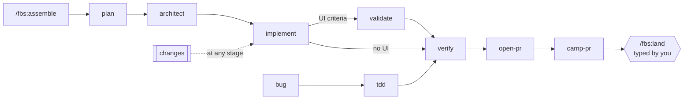

# fbs

An engineering harness for Claude Code: from an idea to a reviewed, verified pull request in one conversation.

fbs is a Claude Code plugin. It plans a feature with you, designs it, builds it test-first with blind review, verifies it, then opens the PR and works it until it is ready to merge. It is for developers who already let an agent write most of their code and want it to stop guessing. A small `fbs` CLI and a few hooks enforce the parts that must hold every time: approvals, the verify stamp, the feature's branch, and a guard that keeps the agent from merging.

<!-- demo GIF: docs/assets/demo.gif -->

## Why

Coding agents are good at writing code and bad at knowing what they don't know.

- **They build on business facts nobody confirmed.** An assumed "we have thousands of users" turns into feature flags and an admin screen nobody needed. fbs keeps a short file of dated, sourced business facts, asks for the ones it is missing, and a script refuses a spec that rests on an unsourced fact or an open question.
- **They miss what a change touches.** A consumer behind an alias, a job, a webhook. fbs maps every code path, API, table, job and screen a change touches, with `path:line` evidence, before it designs anything.
- **They agree too easily.** fbs asks in short rounds, each question with a recommended answer, pushes back once when an answer looks wrong, and puts designs in front of a panel of adversarial reviewers with a judge.
- **They grade their own work.** Every task is reviewed blind by a separate agent that sees the diff and the requirements, never the implementer's report. "Done" needs evidence from the current tree: a green test that asserts the criterion, or a browser run tied to that tree.
- **Prose rules get skipped.** Whether something is approved, verified or allowed to merge is decided by the CLI, not by the model's judgement.
- **It stops only for you.** The agent drives stage to stage and asks only for approvals, real decisions and blockers.

## Install

Requirements:

- Claude Code with plugin support.
- [Bun](https://bun.sh) 1.3 or newer on `PATH`. The `fbs` CLI runs on it.
- git.
- The GitHub CLI `gh`, signed in, for the PR stages (`open-pr`, `camp-pr`, `land`).

The repo is both the plugin and its own marketplace. In Claude Code:

```
/plugin marketplace add fabricio21x/fbs
/plugin install fbs@fabs
```

From a shell:

```bash
claude plugin marketplace add fabricio21x/fbs
claude plugin install fbs@fabs
```

**Update:**

```bash
claude plugin marketplace update fabs
claude plugin update fbs@fabs
```

**Uninstall:**

```bash
claude plugin uninstall fbs@fabs
claude plugin marketplace remove fabs
```

**Optional, for UI work:** the `impeccable` plugin, the `web-design-guidelines` and `vercel-react-best-practices` skills, and the Chrome DevTools MCP server. Architect uses them for UI direction and mockups, the UI implementer and reviewer for building and checking screens, and validate and walkthrough drive the app through the browser tools. When one is missing, the stage says so once and carries on. Install each one by following its own documentation.

**Optional, for `/fbs:polish`:** two third-party review plugins. Polish refuses to run without them and prints these commands:

```
/plugin marketplace add DietrichGebert/ponytail
/plugin install ponytail@ponytail
/plugin install thermos@fabs
```

`thermos` is Cursor's thermo-nuclear review skills, listed in this marketplace at a pinned commit. After installing ponytail, type `/ponytail default off` once, or its hooks start every session, and every fbs agent in it, in ponytail mode.

## How a feature flows

You start everything with `/fbs:assemble`. It finds where the work stands and runs the next stage; each stage continues into the next on its own.

1. **plan** runs first for any new idea: it grills the idea into a spec with sourced facts and acceptance criteria, and sizes it.
2. **architect** runs once the spec is settled: impact map, options, a design, the review panel, your approval.
3. **implement** runs once the design is approved: a task graph, each task built test-first and reviewed blind.
4. **validate** runs when a criterion is a UI flow: it drives the app in a real browser and saves evidence.
5. **walkthrough** runs if you want to see it yourself: a guided tour, your notes turned into to-dos.
6. **verify** runs before any PR: every criterion needs evidence from this tree, and a pass is stamped.
7. **open-pr** runs on a stamped tree: it tidies the commits and opens a draft PR described from the spec.
8. **camp-pr** runs while the PR is open: it triages review comments and CI each round, fixes, replies.
9. **land** runs only when you type `/fbs:land`: it merges if the PR is approved, green and carries the verified tree.



Work is sized first. A tiny change is built directly, test-first. A bug goes through `tdd`. A mid feature gets one document and one approval. A big feature gets a spec and a design, each approved, and can ship as a stack of PRs. Feedback at any point goes through the change path: written down verbatim, sized, amended into the spec or design, approved inline, turned into tasks. See [How it works](docs/how-it-works.md).

## Try it

A feature, from an idea:

```
/fbs:assemble let members export their invoices as CSV from the billing page
```

A bug:

```
/fbs:tdd the cart total ignores the discount when the quantity is changed after applying a coupon
```

Autopilot, for well-defined work with a checkable finish line, while you are away:

```
/fbs:afk get the Lighthouse SEO score of the public pages to 95 or more
```

Picking up later: `/fbs:assemble` with no arguments, or with the feature's slug, resumes wherever the feature stands.

## Skills

Commands are `/fbs:<name>`. Full reference: [docs/skills.md](docs/skills.md).

### Stages

You can type these. Most of the time `/fbs:assemble` runs them for you.

| Command | What it does |
|---|---|
| [`/fbs:assemble`](docs/skills.md#assemble) | The entry: starts an idea or picks a feature up wherever it stands |
| [`/fbs:plan`](docs/skills.md#plan) | Sizes the work: a tiny change is built directly, a bug goes to tdd, a mid or big feature is grilled into a spec with confirmed facts |
| [`/fbs:architect`](docs/skills.md#architect) | Impact map, options, design, review panel, design approval |
| [`/fbs:gulag`](docs/skills.md#gulag) | Adversarial review of a spec or design by five reviewer agents and a judge |
| [`/fbs:implement`](docs/skills.md#implement) | Builds the plan task by task, test-first, each task reviewed blind |
| [`/fbs:tdd`](docs/skills.md#tdd) | Fixes a bug: failing test first, root cause with `path:line`, fix |
| [`/fbs:unslop`](docs/skills.md#unslop) | Removes code slop from the branch without changing behaviour |
| [`/fbs:no-comments`](docs/skills.md#no-comments) | Prunes comments down to the non-obvious whys |
| [`/fbs:polish`](docs/skills.md#polish) | On demand: two third-party simplification reviews, you pick, it applies |
| [`/fbs:setup-validation`](docs/skills.md#setup-validation) | Once per project: how an agent launches, signs in to and drives the app |
| [`/fbs:validate`](docs/skills.md#validate) | Drives the UI criteria in a real browser and saves evidence |
| [`/fbs:walkthrough`](docs/skills.md#walkthrough) | A guided review with you in the running app; notes become to-dos |
| [`/fbs:verify`](docs/skills.md#verify) | The shipping gate: evidence for every criterion, then the stamp |
| [`/fbs:organize-commits`](docs/skills.md#organize-commits) | Folds fix rounds into one commit per task, conventional subjects |
| [`/fbs:open-pr`](docs/skills.md#open-pr) | Opens a draft PR for a verified feature |
| [`/fbs:camp-pr`](docs/skills.md#camp-pr) | Works the PR round by round until it is ready to land |
| [`/fbs:land`](docs/skills.md#land) | The only merge, typed by you |
| [`/fbs:afk`](docs/skills.md#afk) | Autopilot for a task whose finish line is a set of checks |

### Building blocks

Loaded by the stages, not typed.

| Skill | What it does |
|---|---|
| [`changes`](docs/skills.md#building-blocks) | Absorbs a change after approval: record, size, amend, approve, plan |
| [`grilling`](docs/skills.md#building-blocks) | Rounds of up to four questions, each with a recommendation |
| [`impact-map`](docs/skills.md#building-blocks) | Everything a change touches, with `path:line` evidence |
| [`tracker`](docs/skills.md#building-blocks) | Linear or GitHub Issues: reads tickets, proposes and creates the structure |

### Principles

Short rules a stage or agent loads at the step where they apply.

| Principle | The rule |
|---|---|
| [`check-the-facts`](docs/skills.md#principles) | Never build on a business fact nobody confirmed |
| [`smallest-change`](docs/skills.md#principles) | The smallest change and simplest structure; bias to deletion |
| [`model-the-domain`](docs/skills.md#principles) | Name the data shape first; one structure, not scattered conditionals |
| [`test-behavior`](docs/skills.md#principles) | Tests assert required behaviour and fail on a real defect |
| [`prove-it-works`](docs/skills.md#principles) | Verify against the real artifact and quote its output |
| [`fix-root-causes`](docs/skills.md#principles) | Reproduce first, trace to the cause, fix the cause |
| [`boundary-discipline`](docs/skills.md#principles) | Validate outside data once where it enters; trust the types after |
| [`guard-the-context`](docs/skills.md#principles) | Bulk reading goes to subagents; hand off through files |

## Safety

- **The agent never merges.** While a PR flow or an autopilot run is active in a repo, a `PreToolUse` hook denies `gh pr merge`, merge APIs and MCP merge tools, pushes to the default branch and force pushes.
- **Only you land.** `fbs land` needs a one-time token that a hook writes when you type `/fbs:land`, or when you answer the agent's land request with a bare `land`. It also refuses unless the PR is approved (or it is your own solo repo), green, clean, and its head carries exactly the verified tree.
- **The verify stamp.** A passing verdict is bound to the git tree hash. Any code change makes it stale; `open-pr` and `land` refuse without a current one.
- **Approvals are bound to the document.** Editing an approved spec or design makes its approval stale until you approve it again.
- **Autopilot has hard limits.** `/fbs:afk` refuses migrations, new dependencies, infra and product decisions, never edits its own checks, and stops on any flag. It never merges, deploys or touches production. See [docs/afk.md](docs/afk.md).
- **The guard stops the agent, not your credentials.** Turn on branch protection for your default branch; it is the backstop.

## Documentation

| Page | What it covers |
|---|---|
| [How it works](docs/how-it-works.md) | The flow, sizes and routes, approvals and gates, the stamp, changes, what a feature leaves behind, stacks and trackers |
| [Skills and agents](docs/skills.md) | Every skill and agent, and each stage in detail |
| [Autopilot](docs/afk.md) | `/fbs:afk`: eligibility, checks, how the CLI owns the finish line, limits |
| [CLI and hooks](docs/cli.md) | The `fbs` commands, the hooks and where state lives |
| [Contributing](CONTRIBUTING.md) | Setup, tests, evals, releases, conventions |
| [Changelog](CHANGELOG.md) | Release notes |

## Contributing

Issues and pull requests are welcome. Read [CONTRIBUTING.md](CONTRIBUTING.md) first: it covers the checks, how to run evals, and the conventions.

## License

MIT. See [LICENSE](LICENSE).
