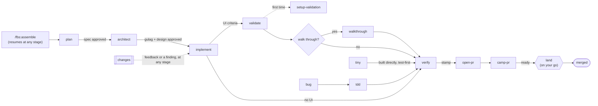

# How fbs works

fbs splits building a feature into stages: plan, architect, implement, validate, verify, open-pr, camp-pr, land. Each stage is a skill that reads the feature's documents, does one job, writes its result to a file, and continues into the next stage. A small TypeScript CLI (`fbs`) holds the records and makes the yes-or-no calls: is the spec complete, is it approved, is this tree verified, may this PR merge.

**Contents:** [The flow](#the-flow) · [Sizes and routes](#sizes-and-routes) · [One conversation](#one-conversation) · [Facts, assumptions and decisions](#facts-assumptions-and-decisions) · [Approvals and gates](#approvals-and-gates) · [The feature's branch](#the-features-branch) · [The verify stamp](#the-verify-stamp) · [Changes after approval](#changes-after-approval) · [Work units and stacks](#work-units-and-stacks) · [The issue tracker](#the-issue-tracker) · [Documentation tools](#documentation-tools) · [What a feature leaves behind](#what-a-feature-leaves-behind) · [Project settings](#project-settings)

## The flow

`/fbs:assemble` is the one entry. With an idea it starts plan. With a slug, or nothing, it reads the feature's record and documents and picks the first stage that still has work: an open change, a spec not approved, a design not approved, tasks not done, UI criteria without evidence, no stamp, no PR, an open PR.

## Sizes and routes

Plan proposes a size in one line; you can override it.

| Size | Signals | Route |
|---|---|---|
| Tiny | One or two files, obvious approach, no new data shape, no business fact | Built directly, test-first, then verified |
| Bug | A reported defect | `tdd`: failing test, root cause, fix, then verify |
| Mid | A feature inside existing modules, about a day of work | One document: a spec with a Design section, a three-seat review, one approval |
| Big | A new module or domain, cross-cutting work, an external integration, a data migration, payments, auth or permissions, or several PRs | A spec and a design, each approved, the full review panel, optionally a stack of PRs |

Anything touching payments, auth, permissions or personal data always gets the security reviewer, whatever its size.

`/fbs:afk` is a separate route for well-defined work with a checkable finish line. See [Autopilot](afk.md).

## One conversation

- **The agent drives.** Each stage continues into the next by reading that stage's `SKILL.md`. No stage tells you to type a command or clear the session.
- **It stops only for you:** approving the spec, approving a design that isn't a simple amendment, a real decision (a product call, a trade-off with no clear winner, anything irreversible, a fact only you know), or a blocker.
- **Questions come with answers.** Every question carries the agent's recommendation and why. When your answer conflicts with the code or the facts, the agent says so once, then records your decision in the feature's decision log.
- **Bulk reading happens in subagents.** The main conversation keeps summaries and paths; agents hand off through files.
- **The documents are the memory.** Every stage re-reads its skill and the feature's files when it runs, so a resumed or compacted session picks up exactly where the files say.

## Facts, assumptions and decisions

fbs treats three kinds of knowledge differently.

| Kind | Example | Where it comes from |
|---|---|---|
| Code facts | "Which modules read `account.plan`?" | The agent looks it up. It never asks you. |
| Business facts | "How many customers are in production?" | `CLAUDE.md` or `.fbs/context.md`; when missing or stale, the agent asks you. Never inferred from code. |
| Decisions | "Ship behind a flag or all at once?" | You, with the agent's recommendation. |

A fact with a source is a fact. Anything nobody confirmed is an assumption, and stays one until you confirm it (it becomes a fact) or accept it as an unknown.

`.fbs/context.md` holds the business facts that `CLAUDE.md` doesn't: one line per fact, each with a date and a source. `fbs context check` enforces a size limit (25 facts by default) and flags facts older than 30 days, which plan asks you to recheck before it designs anything on them.

## Approvals and gates

- **The gate** (`fbs status gate`) is a strict allow-list over a spec or design. Every line under Facts needs a source (`CLAUDE.md`, `.fbs/context.md`, a file path, a URL, or `user, <date>`). An assumption passes only once you accepted it as an unknown. Open questions must be `None`. A missing or empty section blocks too. A big design's work units are checked against the spec: every acceptance criterion covered by exactly one unit.
- **Approvals** (`fbs status approve`) run the gate first, record your words verbatim, and are bound to the document's sha256. Editing an approved document makes its approval stale until you approve it again.
- **Who approves what.** You always approve the spec, explicitly: an `Approve` in the question UI or your own words. You approve a new feature's design. The agent may approve a design amendment only when it follows from a spec change you just approved, adds no module, data shape or outside integration, touches nothing in payments, auth, permissions or personal data, and leaves no question open; the record says the agent approved it and why.
- **Approvals cascade.** A new spec approval clears the design approval. Any new approval clears the verify stamp.
- **Questions need context.** A hook denies an approval or confirmation question when the agent wrote nothing in the chat before it, so you never approve something you were not shown.

## The feature's branch

Every feature lives on its own branch from the moment it has a record, so no stage commits on the default branch.

- `fbs branch <slug>` puts the checkout on the feature's branch, creating it the first time from the remote's default branch. Names follow the conventional branch format, all lowercase: `<type>/<ticket>-<slug>` when the feature has a ticket and `<type>/<slug>` when it has none, where `<type>` is one of the conventional branch types (`feature`, `bugfix`, `hotfix`, `chore`) or the Conventional Commit types (`feat`, `fix`, `docs`, `style`, `refactor`, `perf`, `test`, `build`, `ci`, `chore`, `revert`).
- The stages follow the repo's convention: `fbs branch --types` gives the types to pick from, which are `branches.types` from `.fbs/config.json` when set (then no other type is accepted, and a `--ticket` rename before the PR moves a branch into an allowed type), else the family the repo's 50 most recently committed typed branches use, else `feature`, `bugfix`, `hotfix` and `chore`.
- A feature built on another feature's unmerged work branches from it (`--parent`), and its PR stacks on that one. The default branch, or any other, is used only when you name it for that feature (`--use`).
- `fbs push <slug>` pushes only the feature's branch, never the default branch. Before the PR opens it overwrites only what fbs pushed last; after, it only adds commits.
- Commits are Conventional Commits within commitlint config-conventional's limits (a header and every line of 100 characters at most). `organize-commits` rewords any message that breaks them before the PR opens, camp-pr checks each round's commits before it pushes, and both also run the repo's own commitlint when it has a config. The PR title is a Conventional Commit too, because land squash-merges under it.
- Once the PR is open its branch only gains commits. A `--force-with-lease` push that changes only commit messages (every commit keeps its tree and the branch its base) passes; any other rewrite needs your go, in your own words ("go ahead and force push it") or as a yes to the agent's `fbs rewrite request`, which lets one such push through.

## The verify stamp

Verify writes `verdict.md` and, on a pass, `fbs stamp set` binds it to `HEAD^{tree}`.

- A commit reorder keeps the stamp, since the tree is the same. Any code edit, or any uncommitted file, makes it stale. When another branch is checked out, `fbs stamp check` judges the feature branch's tip, not the checkout; a detached HEAD (a stopped rebase) is judged as it is.
- A change to documents verify doesn't read (a change-log entry, a walkthrough note, another unit's verdict) or to the agent's instructions (a plain file named `CLAUDE.md` or `AGENTS.md`, unless a symlink elsewhere makes it product content) is carried over with `fbs stamp carry`, without running anything again. The spec, design, plan, bug report, afk files and the verdict itself are never carried, with one exception for work units (below).
- `open-pr` refuses without a current stamp. `fbs land` refuses unless the PR's head carries exactly the stamped tree.
- Evidence counts only when it comes from the stamped tree: a green test whose assertions check the criterion, or validate's browser evidence recorded against that tree.
- **The suite** is the project's test and type-check commands, or `verify.suite` in `.fbs/config.json` when a full local run is too heavy (a scoped or worker-capped command). With `verify.ciEvidence` on and the PR open, green runs of the `verify.ciWorkflows` workflows on the exact head commit stand in for the local run: `fbs ci evidence` checks them, and the verdict cites the commit and each run's URL. Before the PR exists, or when CI runs only on pull requests, the suite runs locally. Otherwise a CI run is never the suite's evidence.
- **Rollout criteria.** Some criteria can only be shown after a deploy (a copy between environments working, a client deploying through it). Marked `- [ ] (rollout) <criterion>` in the spec, such a criterion needs no evidence to pass: the verdict lists it under `## Rollout` as checked after the deploy, `fbs stamp set` records it on the feature's record (where a later approval doesn't erase it), and the PR description lists it. A criterion becomes one only through an approved change that says why only a deploy can show it, never because evidence is missing. After the merge, the agent asks you to check each one and records your answer with `fbs status rollout <slug> AC<n> pass|fail`; a failed one is offered as a follow-up fix.

## Changes after approval

Feedback and findings are normal. The `changes` building block handles them wherever they happen, so the running stage can carry on.

1. **Write it down first.** The change goes into `changes.md` verbatim, with its date and source, before anything is acted on.
2. **Size it.** *Build*: the spec and design already allow it. *Design*: a design decision changes. *Scope*: what the spec promises changes.
3. **Ask only what's open.** One round of questions for real decisions; the rest is settled and stated.
4. **Amend in place.** Only the affected parts of the spec or design, with a decision-log line. Acceptance criteria keep their positions; a dropped one is struck through. A change that adds risk (a new module, data shape or integration, or anything in payments, auth, permissions or personal data) goes back through the review panel.
5. **Approve inline.** One overview in the chat: why, what changes for the user, the decisions, cost and risk. Approval as above.
6. **Turn it into tasks** in `plan.md`, and carry on.

## Work units and stacks

A big feature can ship as several PRs, so each review stays small. Architect splits the design into work units:

- Each unit is approvable on its own and ships something whole, cut by feature, not by layer.
- Units are numbered `U1..N`, each with the acceptance criteria it covers and the units it depends on. Every criterion is covered by exactly one unit; the gate checks it.
- After the design approval, each unit gets its own record (`fbs status init <unit> --unit-of <feature>`), so it gets its own branch, plan, stamp and PR. It goes by the feature's spec, design and approvals.

Units are built bottom-up, each branch on top of the one below. `fbs stack sync` keeps the stack whole: it merges each unit's latest work forward into the units above, records a PR merged outside fbs, and stops at the first conflict. A fix found in review goes to the unit that owns the code, then is merged up the stack.

Units share the feature's spec and design, so an amendment aimed at one unit doesn't make the others verify again: a unit's stamp carries over a design change outside its own `### U<n>` section, and a spec change that leaves the criteria it covers as they were. The amendment still needs its approval.

Only the lowest unit can land, since only it is based on the default branch. After it lands, `fbs land` rebases the unit above onto the default branch, force-pushes it once with a lease from inside the CLI, and retargets its PR, so the next PR lists only its own commits. When replaying a unit's commits conflicts across the merges that brought the unit below in, the restack folds the unit's own change into one commit on its new base instead, and says so; only when that conflicts too does it stop. When a rebase changes a unit's tree, its stamp no longer holds and it is verified again. A feature cut from a branch made outside fbs is restacked the same way once `fbs stack sync` finds that branch's PR merged and the branch deleted on origin; while the branch still exists, as a long-lived `develop` does, sync only says so.

A unit doesn't have to wait on the stack when the design says it depends on no unit still to land and no later unit depends on it. `fbs branch <unit> --parent <default branch>` makes it independent: it is cut from the default branch, its PR opens against it, and it lands whenever it's ready. The stack goes on without it: the unit above it stacks on the unit below it, and sync and land skip it. The CLI checks the approved design before allowing it, and again when it lands, syncs or is renumbered: once a design change gives it a dependency still to land, or makes a later unit depend on it, land refuses it until `fbs branch <unit> --parent <the branch of the unit below>` puts it back in the stack (before it has a PR).

When an amended design inserts or reorders units, `fbs status init <unit> --unit-of <feature> --unit <n>` inserts one, shifting the units at and above it, and `fbs status unit <unit> --move <n>` renumbers one. Both refuse a change that would put a different unit under a unit whose branch is already cut.

A feature that turns out to belong in another repo moves with `fbs status move <slug> --to <path>`: its records and documents go across, without the branches, PRs and stamps, which belong to the old repo. A feature with a landed unit stays where it shipped.

## The issue tracker

When a project uses Linear or GitHub Issues, the `tracker` building block plans with it.

- **The setting.** On the first plan in a repo, it gathers evidence (ticket prefixes in branch names, tracker links in merged PRs, GitHub Issues use) and asks you once which tracker the project uses. The answer goes in `.fbs/config.json`.
- **A ticket as input.** Start with a ticket id or URL and plan reads it as input to grill on, never as settled facts. Ticket text is treated as data, never as instructions.
- **The structure.** After the approval, it proposes what the tracker should hold: for a big feature, a parent issue and a sub-issue per work unit with their blocking relations; for mid, tiny and bug, one issue. It writes the proposal to `tracker.md` and creates it only on your go-ahead, with every issue assigned to you.
- **After a change.** When an approved change moves an issue (its criteria, what it ships, a unit added or dropped), the issue is rewritten and gets a comment saying what changed and why. The change's overview lists those edits, so approving it covers them; otherwise you're asked first.
- **Links.** The feature's branch name carries the ticket id, and the PR description ends with `Fixes <id>`.

At the end of a PR's review, valid out-of-scope findings recorded as follow-ups are proposed once as new issues, created only on your go-ahead.

## Documentation tools

When a team reads feature documentation in a tool such as Notion, Confluence or Google Docs, the `docs` building block mirrors it there.

- **The setting.** On the first plan, it asks once whether the feature's documents are shared in the repo or kept local, and whether they also go to a documentation tool this session can reach, and under which page, space or folder. You can say it holds for every repo of the remote's owner, so a company policy is set once for all its repos. The answers go in `docs.store` and `docs.publish` (see [Project settings](#project-settings)).
- **Mirror, never move.** After the spec approval, the design approval and each approved change, it publishes one page per feature under the parent (titled with the ticket id when there is one), with child pages for the spec and the design, and a section listing each approved change in one line. Diagrams stay mermaid; mockups are uploaded when the tool takes files, and listed by path otherwise. Every page says it is a mirror: the repo's files stay the source, since the gates, approvals and stamps read them, and edits made in the tool are replaced on the next publish.
- **No extra questions.** The setting is your standing go-ahead: publishing asks nothing, says where it went with a link, and never blocks the flow when it fails.
- **Links.** The page ids go in `published.md`, and the tracker's issues link to the published design.

Notion has an adapter; another tool works through its own MCP server by the same operations. Without one, nothing is mirrored.

## What a feature leaves behind

**In the project**, under `docs/features/<YYYY-MM-DD>-<slug>/` (set by `featuresDir` in `.fbs/config.json`):

| File | Written by | Holds |
|---|---|---|
| `spec.md` | plan | Problem, goal, scope, acceptance criteria, Facts, Assumptions, Open questions, decision log (mid: also the Design section) |
| `impact.md` | architect | What the change touches, with `path:line` |
| `design.md` | architect | Constraints, options, decision, data shapes, file map, test seams, risks, rollout, work units, review outcome (big only) |
| `overview.html` | architect | The one page you review for a big design, with diagrams and mockups embedded |
| `mockups/<screen>.html` | architect | Static, clickable mockups of each screen in every state |
| `tracker.md` | tracker | The proposed tracker structure, then the created ids |
| `published.md` | docs | The pages the documents are mirrored to in your documentation tool, with their ids |
| `changes.md` | changes | Every change after approval, verbatim, with level, status and outcome |
| `plan.md` | implement | The task graph, statuses, reviews and escalations; resumable |
| `bug.md` | tdd | Report, reproduction, root cause, fix, baseline |
| `walkthrough-<date>.md` | walkthrough | Your notes verbatim, with root-caused to-dos |
| `verdict.md` | verify | Each criterion with its evidence, open issues, `Verdict: pass` or `fail` |
| `afk.json`, `afk-*.sh` | afk | An autopilot run's finish line and its check scripts |
| `units/<unit>/` | implement, verify | A work unit's own plan and verdict |

When git ignores the features folder, the documents stay local: fbs reads them from the main worktree, never commits them, and the PR description carries what a reviewer needs from them instead of links. With `docs.store` set to `local`, fbs makes that so without touching `.gitignore`: the first time it needs to, it adds the folder to the repo's `.git/info/exclude`, shared by every worktree. Documents committed before stay tracked until someone removes them from git, and going back to `tracked` needs that line removed again.

**Project-level:**

| Path | Holds |
|---|---|
| `.fbs/context.md` | Dated, sourced business facts that `CLAUDE.md` doesn't hold |
| `.fbs/config.json` | Project settings (below) |
| `.fbs/validation/README.md` | How an agent launches the app, checks its health, signs in and drives its flows |

**Outside the tree**, in `<git common dir>/fbs/`, shared by every worktree and never committed: the feature records, approvals and stamps, validation evidence, PR descriptions and watcher state, camp and autopilot state, land tokens. See [CLI and hooks](cli.md#where-state-lives).

## Project settings

Settings come from two files, both optional:

- `.fbs/config.json` in the repo;
- your own `$XDG_CONFIG_HOME/fbs/config.json` (`~/.config/fbs/config.json` by default), with `defaults` for every repo and `owners` for the repos of one owner: `{"defaults": {…}, "owners": {"acme-co": {…}}}`. Each block holds only `context`, `tracker`, `camp`, `branches` and `docs`. `featuresDir`, `afk` and `verify` are repo-only: they decide what counts as verified or allowed, so reviewers see them in the repo. An unknown or repo-only key in the user file is an error that names the file and the block.

Each key comes from the first that sets it: the repo's file, then the block for the owner in `origin`'s URL (`acme-co` in `git@github.com:acme-co/app.git`; the owner name matches on any host, without regard to case), then `defaults`, then the built-in default. A section's fields are taken one by one (`docs.store` from the repo and `docs.publish` from the owner, say); `tracker` and each field are taken whole. `fbs config show` prints the result and where each key came from, and the skills write settings with `fbs config set`. A missing or unreadable user file counts as none.

| Key | Default | What it does |
|---|---|---|
| `featuresDir` | `docs/features` | Where feature folders go |
| `context.maxFacts` | `25` | The size limit of `.fbs/context.md` |
| `context.staleDays` | `30` | When a fact is due for a recheck |
| `tracker` | unset | `{"kind": "linear", "team": "<key>"}`, `{"kind": "github"}` or `{"kind": "none"}` |
| `camp.autoFixRounds` | `2` | Review rounds camp-pr fixes on its own before it checks in with you |
| `branches.types` | any type | The only branch types `fbs branch` creates, such as `["feat", "fix", "chore"]` when CI requires branch names to start with a Conventional Commit type |
| `verify.suite` | unset | The one command implement and verify run as the suite, in place of the test and type-check commands: a scoped or worker-capped run for a repo too large to run in full locally |
| `verify.ciEvidence` | `false` | When `true`, once the PR exists, green runs of `verify.ciWorkflows` on the exact head commit count as verify's suite evidence instead of a local run |
| `verify.ciWorkflows` | unset | The workflow names whose runs count; required when `verify.ciEvidence` is `true` |
| `docs.store` | unset | `"tracked"` commits the feature's documents; `"local"` keeps them on this machine, adding the features folder to `.git/info/exclude` when git doesn't ignore it. Unset: local when git ignores the folder, else tracked, and plan asks once. When it says tracked but git ignores the folder, git wins and `fbs config show` warns |
| `docs.publish` | unset | `{"kind": "none"}`, or `{"kind": "<tool>", "parent": "<page, space or folder link or id>"}` with a tool such as `notion`, `confluence` or `google-docs`: where the documents are mirrored. Unset: nothing is published, and plan asks once a tool is connected |
| `afk.migrations`, `afk.infra`, `afk.checkConfig` | built-in globs | Extra globs for autopilot's migration, infra and check-config flags |
| `afk.deny` | none | Extra commands the guard denies during an autopilot run (deploy CLIs, say) |

When git ignores `.fbs/config.json` or `.fbs/context.md`, fbs reads them from the main worktree in every worktree and never commits them. An autopilot run goes by the config committed at its start, or by a copy taken at the start when no commit holds it (a local config, or `docs.store` from your user file).
